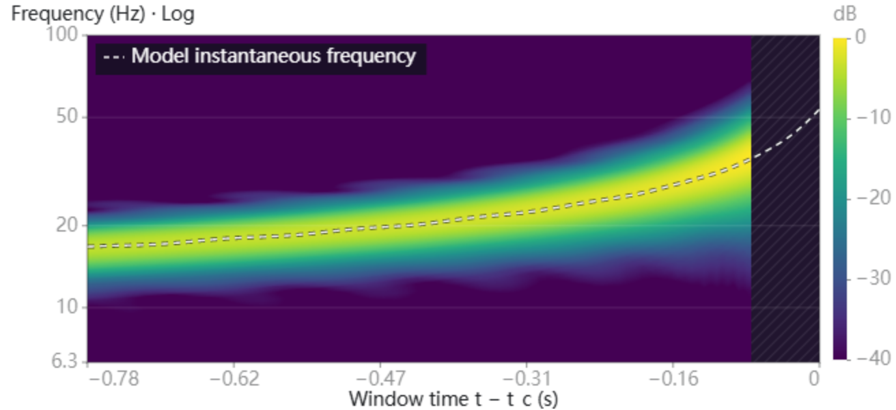
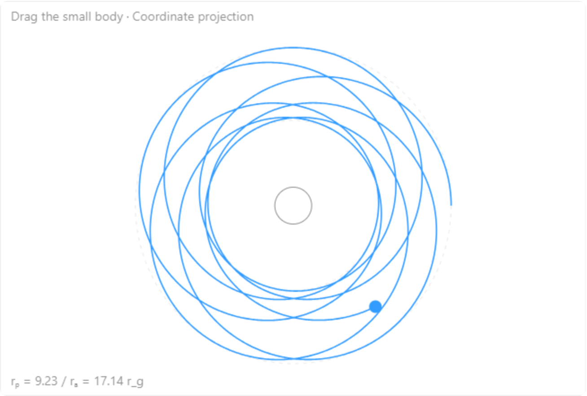

# 引力波轨道实验室 · GW Orbit Lab

拖动天体，按下播放，看看双星怎样越转越快，或者让一颗小天体在黑洞旁画出进动花瓣。支持双星、三体和 Schwarzschild 测地线三种模式。

**[在线试玩](https://suhongqwq.github.io/gw-orbit-lab/)** · 下载 `index.html` 也可离线打开

## 并合前的啁啾

*运行 GW150914 的质量预设。播放到示意并合后，勾选「并合前视图」，即可在默认的频率优先长窗下观察上扬的亮带。也可以切到时间优先短窗或 CQT。*

## 黑洞旁的进动花瓣

*从预设菜单选「典型 EMRI」。每圈的近心点都在转动，轨迹逐渐画出花瓣。*

二维、无初始自旋的教学玩具模型。双星和三体可选有限阶后牛顿近似，Schwarzschild 使用固定背景测地线。完整数值相对论演化超出模型范围。
